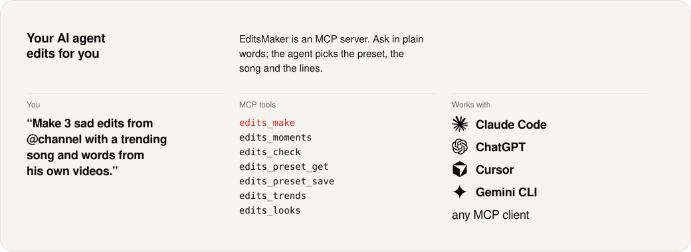
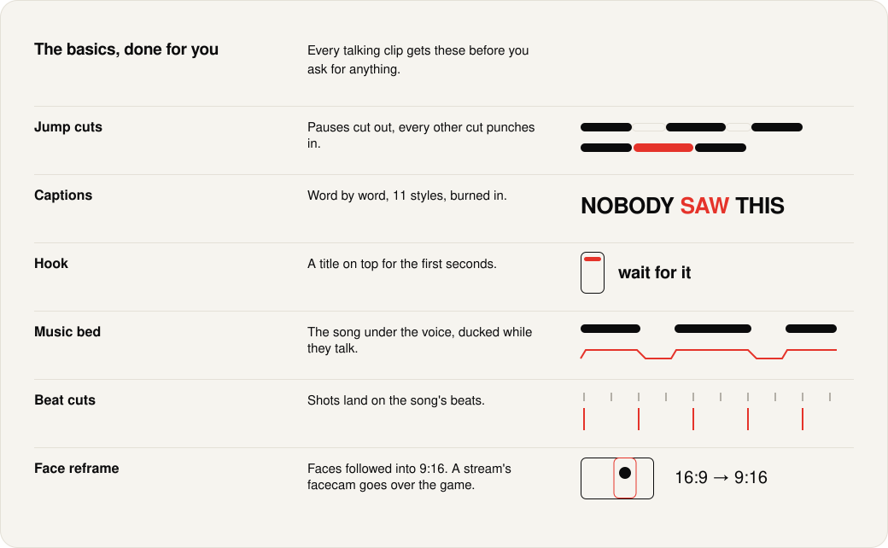
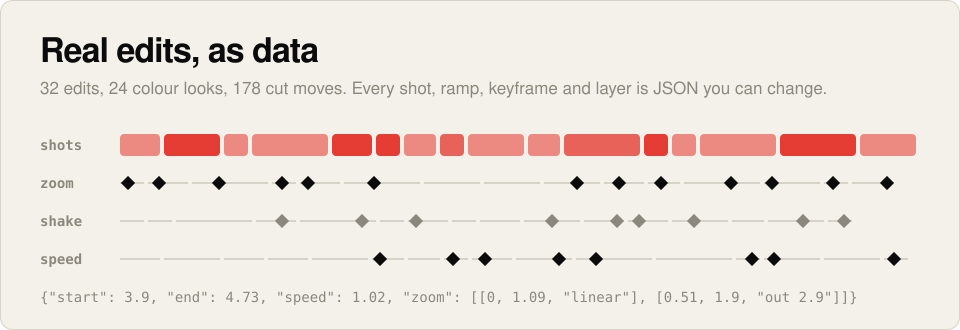
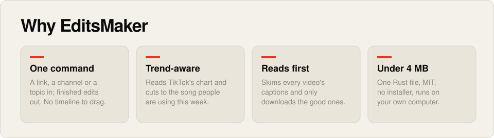

<picture>
  <source media="(prefers-color-scheme: dark)" srcset="assets/readme/hero-dark.svg">
  
</picture>

<p align="center">
  <a href="https://github.com/OnurByte/EditsMaker/releases/latest"><b>Download</b></a> ⁜ Linux, macOS and Windows
</p>

<picture>
  <source media="(prefers-color-scheme: dark)" srcset="assets/readme/badges-dark.svg">
  
</picture>

<picture>
  <source media="(prefers-color-scheme: dark)" srcset="assets/readme/agents-dark.svg">
  
</picture>

## Install

### <picture><source media="(prefers-color-scheme: dark)" srcset="assets/readme/os-apple-dark.svg"></picture> <picture><source media="(prefers-color-scheme: dark)" srcset="assets/readme/os-linux-dark.svg"></picture> macOS and Linux

```sh
curl -fsSL https://raw.githubusercontent.com/OnurByte/EditsMaker/main/install.sh | sh
```

### <picture><source media="(prefers-color-scheme: dark)" srcset="assets/readme/os-windows-dark.svg"></picture> Windows

```powershell
irm https://raw.githubusercontent.com/OnurByte/EditsMaker/main/install.ps1 | iex
```

Then check what is missing. You also need [ffmpeg](https://ffmpeg.org) and [yt-dlp](https://github.com/yt-dlp/yt-dlp).

```sh
edits doctor
```

### Or ask your agent

```text
Install EditsMaker from github.com/OnurByte/EditsMaker, run "edits doctor", add it as an MCP server with "edits mcp" and install its skills with "edits skills install".
```

<picture>
  <source media="(prefers-color-scheme: dark)" srcset="assets/readme/loop-dark.svg">
  
</picture>

<picture>
  <source media="(prefers-color-scheme: dark)" srcset="assets/readme/steps-dark.svg">
  
</picture>

```sh
edits https://www.youtube.com/@channel --preset yuraprst --music trend:3 --look tealorange
```

### Made with it

<table>
  <tr>
    <td align="center"><video src="https://github.com/user-attachments/assets/b8791efc-8e9c-4dfa-86cf-314610cd6013" width="180" controls></video><br><sub>Velocity preset</sub></td>
    <td align="center"><video src="https://github.com/user-attachments/assets/caa41be2-47f4-4f32-bde0-53b87bbde2ca" width="180" controls></video><br><sub>Alight Motion preset</sub></td>
    <td align="center"><video src="https://github.com/user-attachments/assets/62d9bf57-3a64-42e7-b92a-b8af929f41b7" width="180" controls></video><br><sub>Sad edit</sub></td>
    <td align="center"><video src="https://github.com/user-attachments/assets/deedfb5a-d044-400d-af0d-884ec000410a" width="180" controls></video><br><sub>Sad edit, own voice</sub></td>
  </tr>
</table>

<sub>Every one is a single `edits` command. GitHub starts videos muted: click 🔊 on each.</sub>

<picture>
  <source media="(prefers-color-scheme: dark)" srcset="assets/readme/features-dark.svg">
  
</picture>

<picture>
  <source media="(prefers-color-scheme: dark)" srcset="assets/readme/fx-dark.svg">
  
</picture>

<picture>
  <source media="(prefers-color-scheme: dark)" srcset="assets/readme/basics-dark.svg">
  
</picture>

<picture>
  <source media="(prefers-color-scheme: dark)" srcset="assets/readme/presets-dark.svg">
  
</picture>

<picture>
  <source media="(prefers-color-scheme: dark)" srcset="assets/readme/why-dark.svg">
  
</picture>

---

<details>
<summary><b>Command line</b></summary>

Replay a preset over a channel's videos:

```sh
edits https://www.youtube.com/@channel --preset yuraprst
```

Cut it to TikTok's 3rd trending song:

```sh
edits https://www.youtube.com/@channel --preset yuraprst --music trend:3
```

Colour and frame:

```sh
edits https://www.youtube.com/@channel --preset yuraprst --look tealorange --aspect 4:5
```

Read 12 videos' captions, download only the best 4:

```sh
edits https://www.youtube.com/@channel --preset yuraprst --videos 12 --use 4
```

Calmer moves (2 is wilder):

```sh
edits https://www.youtube.com/@channel --preset yuraprst --intensity 0.6
```

A sad music montage without a preset:

```sh
edits https://www.youtube.com/@channel --music song.mp3 --sad
```

Talking clips: pauses cut, word-by-word captions, a hook on top, music under the voice:

```sh
edits https://www.youtube.com/@channel -n 3 --captions hormozi --bed trend:7
```

Caption styles: hormozi, mrbeast, karaoke, box, minimal, neon:

```sh
edits https://www.youtube.com/watch?v=VIDEO_ID --captions mrbeast
```

Hits on the hardest beats, speed ramps and words on screen:

```sh
edits https://www.youtube.com/@channel --preset yuraprst --velocity --fx shake,rgb,freeze --line "Nobody saw this coming."
```

Slow, faster, hidden faces, a cleaner finish:

```sh
edits https://www.youtube.com/watch?v=VIDEO_ID --speed 1.2 --blur-faces --stabilize --denoise --codec h265
```

Draw on it to point things out: an arrow, a ring, a cross, a burst, or your own .svg (`edits looks` lists them):

```sh
edits draw clip.mp4 "arrow@0.5-2.5:0.62,0.3,0.3" "circle@3-5:0.5,0.4,0.6#ffffff" "question@8-10:0.75,0.2,0.2"
```

What is trending on TikTok:

```sh
edits trends
```

Colour looks, caption styles, hits and stickers, including 24 looks from Alight Motion colour packs:

```sh
edits looks
```

Reverse-engineer an edit you like into a preset (its cuts, flashes and every shot's zoom, slide, turn and shake),
then replay it over your own footage:

```sh
edits learn liked-edit.mp4
```

Or make a preset from scratch for your footage: the video sets the rhythm, other presets lend the moves.

```sh
edits preset create footage.mp4 --name mine --like yuraprst,madara
```

Measure a finished clip: length, loudness, cut rhythm and a contact sheet to look at (the same as the `edits_check` tool):

```sh
edits check ~/Videos/edits/2026-11-16/"21.04 Video title"/01-VIDEO_ID.mp4
```

Timelines for other editors beside each clip (`fcpxml`, `edl`, captions as `srt` or `vtt`):

```sh
edits https://www.youtube.com/watch?v=VIDEO_ID --export fcpxml,srt,vtt
```

A look as a .cube LUT for Premiere, DaVinci Resolve or CapCut:

```sh
edits cube rajjcc-4
```

Speaking another language? Set it once (it also picks the country for `trend:N`); the words for each language live
in `presets/lang.json`, the model prompts in `presets/prompts.json`:

```sh
export EDITS_LANG=tr
```

Presets:

```sh
edits preset list
```

One preset in full:

```sh
edits preset show yuraprst
```

Save a changed preset:

```sh
edits preset save my-preset.json
```

Import Alight Motion or Premiere presets:

```sh
edits preset import presets.zip
```

Take a whole editing pack in (sound effects, music, overlays, transitions, green screens, memes, images, fonts and
presets) and use it by name:

```sh
edits library add pack.zip
edits library sfx whoosh
edits <link> --music "montagem rave" --overlay "vhs texture:0.5" --overlay "burn 3@4.2"
edits <link> --whoosh "main swoosh" --boom "bass drop"
```

The files stay on your machine in `~/.config/edits/library`. Textures run screened under the whole edit, a
transition or meme plays once where you put it, green screens are keyed.

Check the tools:

```sh
edits doctor
```

</details>

<details>
<summary><b>Presets</b></summary>

30 edits (anime and 9:16 community edits made in Alight Motion) and 178 cut moves (Premiere transitions), kept as
JSON in [`presets/`](presets). Nothing is fixed: print one whole, change shots, speed, zooms, shakes, flashes,
look or song, then use the file for one edit or save it. With another song, cuts move onto its beats.

```sh
edits preset show yuraprst > my-preset.json
```

```sh
edits https://www.youtube.com/@channel --preset my-preset.json
```

```sh
edits preset save my-preset.json
```

</details>

<details>
<summary><b>Agents</b></summary>

Add it to Claude Code:

```sh
claude mcp add edits -s user -- edits mcp
```

Install the skills:

```sh
edits skills install
```

Tools: `edits_make`, `edits_presets`, `edits_preset_get`, `edits_preset_save`, `edits_looks`, `edits_trends`,
`edits_doctor`. An agent reads a preset, changes it for the footage and renders with it.

</details>

<details>
<summary><b>Build from source</b></summary>

```sh
cargo install --git https://github.com/OnurByte/EditsMaker
```

Only cut what you have the rights to: songs, footage and presets belong to their makers.

</details>

<details>
<summary><b>Contributing</b></summary>

Fixes, presets and looks are welcome: see [CONTRIBUTING.md](CONTRIBUTING.md).

[MIT](LICENSE). The face model is [rustface](https://github.com/atomashpolskiy/rustface)'s (BSD-2).

</details>
