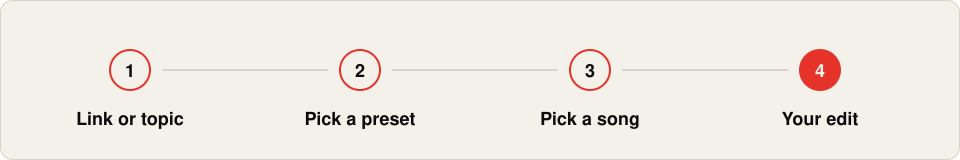
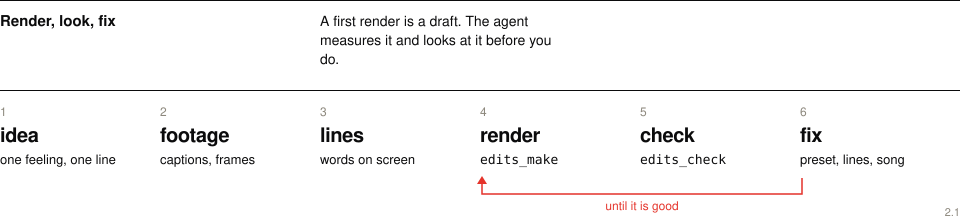
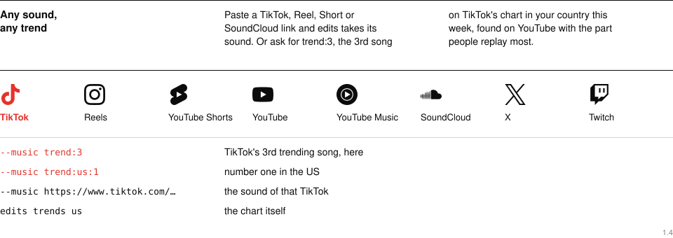
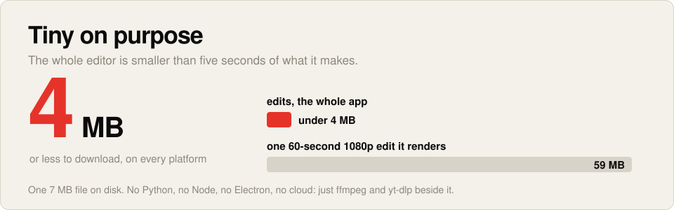
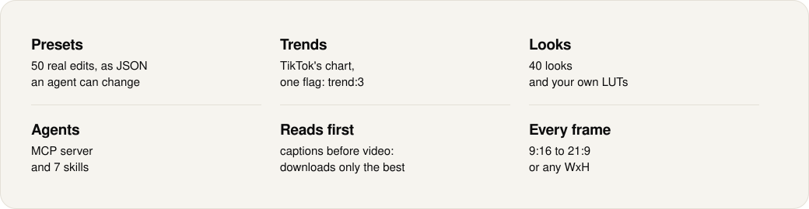
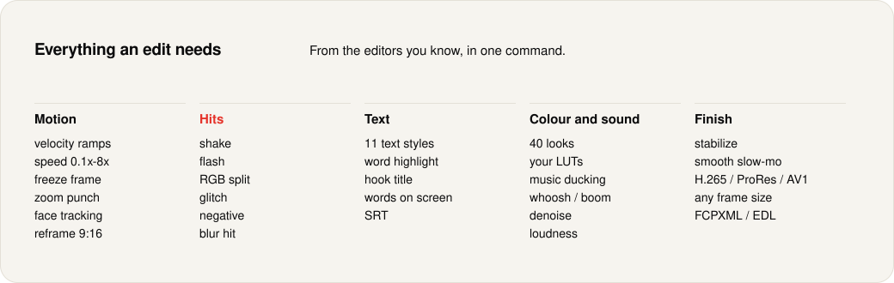

<picture>
  <source media="(prefers-color-scheme: dark)" srcset="assets/readme/hero-dark.svg">
  
</picture>

<a href="#install">
<picture>
  <source media="(prefers-color-scheme: dark)" srcset="assets/readme/download-dark.svg">
  
</picture>
</a>

<picture>
  <source media="(prefers-color-scheme: dark)" srcset="assets/readme/badges-dark.svg">
  
</picture>

## Made with it

<table>
  <tr>
    <td align="center"><video src="https://github.com/user-attachments/assets/b8791efc-8e9c-4dfa-86cf-314610cd6013" width="180" controls></video><br><sub>Velocity preset</sub></td>
    <td align="center"><video src="https://github.com/user-attachments/assets/caa41be2-47f4-4f32-bde0-53b87bbde2ca" width="180" controls></video><br><sub>Alight Motion preset</sub></td>
    <td align="center"><video src="https://github.com/user-attachments/assets/62d9bf57-3a64-42e7-b92a-b8af929f41b7" width="180" controls></video><br><sub>Sad edit</sub></td>
    <td align="center"><video src="https://github.com/user-attachments/assets/deedfb5a-d044-400d-af0d-884ec000410a" width="180" controls></video><br><sub>Sad edit, own voice</sub></td>
  </tr>
</table>

<sub>Every one is a single `edits` command. 🔊 for sound.</sub>

## How it works

<picture>
  <source media="(prefers-color-scheme: dark)" srcset="assets/readme/steps-dark.svg">
  
</picture>

```sh
edits https://www.youtube.com/@channel --preset spin-slide-shake --music trend:3 --look tealorange
```

<picture>
  <source media="(prefers-color-scheme: dark)" srcset="assets/readme/agents-dark.svg">
  
</picture>

<picture>
  <source media="(prefers-color-scheme: dark)" srcset="assets/readme/loop-dark.svg">
  
</picture>

## Why it wins

<picture>
  <source media="(prefers-color-scheme: dark)" srcset="assets/readme/sounds-dark.svg">
  
</picture>

<picture>
  <source media="(prefers-color-scheme: dark)" srcset="assets/readme/size-dark.svg">
  
</picture>

<a href="https://github.com/yt-dlp/yt-dlp/blob/master/supportedsites.md">
  <picture>
    <source media="(prefers-color-scheme: dark)" srcset="assets/readme/sites-dark.svg">
    
  </picture>
</a>

## Everything it does

<picture>
  <source media="(prefers-color-scheme: dark)" srcset="assets/readme/features-dark.svg">
  
</picture>

<picture>
  <source media="(prefers-color-scheme: dark)" srcset="assets/readme/fx-dark.svg">
  
</picture>

<picture>
  <source media="(prefers-color-scheme: dark)" srcset="assets/readme/basics-dark.svg">
  
</picture>

<picture>
  <source media="(prefers-color-scheme: dark)" srcset="assets/readme/presets-dark.svg">
  
</picture>

## Install

### <picture><source media="(prefers-color-scheme: dark)" srcset="assets/readme/os-apple-dark.svg"></picture> <picture><source media="(prefers-color-scheme: dark)" srcset="assets/readme/os-linux-dark.svg"></picture> macOS and Linux

<sub>Terminal</sub>

```sh
curl -fsSL https://raw.githubusercontent.com/OnurByte/EditsMaker/main/install.sh | sh
```

### <picture><source media="(prefers-color-scheme: dark)" srcset="assets/readme/os-windows-dark.svg"></picture> Windows

<sub>PowerShell</sub>

```powershell
irm https://raw.githubusercontent.com/OnurByte/EditsMaker/main/install.ps1 | iex
```

### Or ask your agent

```text
Install EditsMaker from github.com/OnurByte/EditsMaker, then run "edits mcp install" and "edits skills install".
```

---

<details>
<summary><b>Command line</b></summary>

Replay a preset over a channel's videos:

```sh
edits https://www.youtube.com/@channel --preset spin-slide-shake
```

Cut it to TikTok's 3rd trending song:

```sh
edits https://www.youtube.com/@channel --preset spin-slide-shake --music trend:3
```

Colour and frame:

```sh
edits https://www.youtube.com/@channel --preset spin-slide-shake --look tealorange --aspect 4:5
```

Read 12 videos' captions, download only the best 4:

```sh
edits https://www.youtube.com/@channel --preset spin-slide-shake --videos 12 --use 4
```

Calmer moves (2 is wilder):

```sh
edits https://www.youtube.com/@channel --preset spin-slide-shake --intensity 0.6
```

A sad music montage without a preset:

```sh
edits https://www.youtube.com/@channel --music song.mp3 --sad
```

Talking clips: pauses cut, word-by-word captions, a hook on top, music under the voice:

```sh
edits https://www.youtube.com/@channel -n 3 --captions hormozi --bed trend:7
```

Caption styles: hormozi, mrbeast, karaoke, box, minimal, neon:

```sh
edits https://www.youtube.com/watch?v=VIDEO_ID --captions mrbeast
```

Hits on the hardest beats, speed ramps and words on screen:

```sh
edits https://www.youtube.com/@channel --preset spin-slide-shake --velocity --fx shake,rgb,freeze --line "Nobody saw this coming."
```

Slow, faster, hidden faces, a cleaner finish:

```sh
edits https://www.youtube.com/watch?v=VIDEO_ID --speed 1.2 --blur-faces --stabilize --denoise --codec h265
```

Premiere's finishing moves as flags: a picture in picture, a transition on every soft cut, a tone curve, a colour
pop, phonk bass, the song a step lower and a room behind it:

```sh
edits <link> --music trend:2 --pip reaction.mp4@2-8:0.75,0.2,0.35 --transition circleopen --curves vintage \
  --pop red --bass 6 --pitch -2 --reverb
```

Words that land: the caption and the spoken line slam in on the punchline, dark footage brought up first:

```sh
edits <link> --preset karakter-buyuk --say ID@12.4-15.1 --say-text --caption "bu adam 🗿@0-2.5" --anim slam --fix
```

Draw on it to point things out: an arrow, a ring, a cross, a burst, or your own .svg (`edits looks` lists them):

```sh
edits draw clip.mp4 "arrow@0.5-2.5:0.62,0.3,0.3~pop" "circle@3-5:0.5,0.4,0.6#ffffff" "question@8-10:0.75,0.2,0.2~slam"
```

What is trending on TikTok:

```sh
edits trends
```

Colour looks, caption styles, hits and stickers, including 24 looks from Alight Motion colour packs:

```sh
edits looks
```

Reverse-engineer an edit you like into a preset (its cuts, flashes and every shot's zoom, slide, turn and shake),
then replay it over your own footage:

```sh
edits learn liked-edit.mp4
```

Or make a preset from scratch for your footage: the video sets the rhythm, other presets lend the moves.

```sh
edits preset create footage.mp4 --name mine --like spin-slide-shake,flash-velocity-square
```

Measure a finished clip: length, loudness, cut rhythm and a contact sheet to look at (the same as the `edits_check` tool):

```sh
edits check ~/Videos/edits/2026-11-16/"21.04 Video title"/01-VIDEO_ID.mp4
```

Look at moments of the footage before picking shots by hand (`edits_frames`): one row of frames per time, in one jpg:

```sh
edits frames VIDEO_ID 5:36 390+4 414
```

Find where a line is said, ready for `--say` (`edits_words`), and change a preset without a script (`edits_preset_set`):

```sh
edits words VIDEO_ID --find "say my name"
edits preset set sert-bw total=12 shots.*.speed=2 --as sert-fast
```

Timelines for other editors beside each clip (`fcpxml`, `edl`, captions as `srt` or `vtt`):

```sh
edits https://www.youtube.com/watch?v=VIDEO_ID --export fcpxml,srt,vtt
```

A look as a .cube LUT for Premiere, DaVinci Resolve or CapCut:

```sh
edits cube rajjcc-4
```

Speaking another language? Set it once (it also picks the country for `trend:N`); the words for each language live
in `presets/lang.json`, the model prompts in `presets/prompts.json`:

```sh
export EDITS_LANG=tr
```

Presets:

```sh
edits preset list
```

One preset in full:

```sh
edits preset show spin-slide-shake
```

Save a changed preset:

```sh
edits preset save my-preset.json
```

Import Alight Motion projects, CapCut drafts (the draft folder or its zip) or Premiere presets:

```sh
edits preset import presets.zip
```

Take a whole editing pack in (sound effects, music, overlays, transitions, green screens, memes, images, fonts and
presets) and use it by name:

```sh
edits library add pack.zip
edits library sfx whoosh
edits <link> --music "montagem rave" --overlay "vhs texture:0.5" --overlay "burn 3@4.2"
edits <link> --whoosh "main swoosh" --boom "bass drop"
```

Meme edits in one command: words with emoji, the spoken line on screen, math flashing in on the cuts, subliminal
frames, an intro from another video and the EditsMaker card at the end:

```sh
edits <link> --preset karakter-buyuk --say ID@1500.4-1504.7 --say-text --math --caption "sayın barış özbay 🗿@0-3.5" \
  --flash-text "5.2:dışarısı bir simülasyon" --intro "OTHERID@3351.5-3354.9" --intro-bed "fluffing a duck" \
  --intro-caption "avenox 🤡" --outro edits
```

The files stay on your machine in `~/.config/edits/library`. Textures run screened under the whole edit, a
transition or meme plays once where you put it, green screens are keyed.

Check the tools:

```sh
edits doctor
```

</details>

<details>
<summary><b>Premiere, flag by flag</b></summary>

What a Premiere Pro editor reaches for, and where it is in edits. Every row runs from the command line, the MCP
server and preset JSON; no timeline to drag.

| Premiere | edits |
|---|---|
| Razor and ripple delete, jump cuts | automatic; `--no-jumpcuts` keeps the pauses |
| Text-based editing (cut by the transcript) | `--say ID@A-B` picks whole words; `+G+` joins lines with a gap |
| Speed / Duration, Time Remapping | `--speed`, `--velocity`, a preset shot's `speed` and `ramp` curve |
| Reverse speed | a preset shot's `"reverse": true` |
| Frame hold | `--fx freeze` on the hardest beats |
| Optical flow | `--smooth` (motion-interpolated frames), `--fps` |
| Motion: scale, position, rotation keyframes | a preset shot's `zoom`, `x`, `y`, `rot` curves with easing; 178 Premiere cut moves built in |
| Video transitions | `--transition` with every ffmpeg xfade: dissolve, wipes, slides, push, iris, pixelize, squeeze |
| Picture in picture, nested video track | `--pip FILE[@FROM-TO][:X,Y,SIZE]` |
| Blend modes, overlays, light leaks | `--overlay NAME[@FROM-TO][:OPACITY]`, screened; alpha clips laid on top |
| Ultra Key (green screen) | green screens from the library are keyed automatically |
| Auto Reframe | faces followed into any `--aspect` or `--size`; `--fit` keeps the whole frame |
| Warp Stabilizer | `--stabilize` |
| Lumetri: basic correction | a preset shot's `exposure`, `contrast`, `saturation`, `kelvin` |
| Lumetri: curves | `--curves vintage` or your own points `"0/0 0.4/0.3 1/1"`; per shot `"curves"` |
| Lumetri: HSL secondary | `--pop red` keeps one colour, the rest grey; per shot `"pop"` |
| Lumetri: creative look, LUTs | `--look` (40 looks), `--lut FILE.cube`, `edits cube` writes one out |
| Gaussian blur, mosaic | `--blur-faces`, `--blur-box`, per shot `blur`, `pixelate` |
| CapCut: split screen, mirror | per shot `split` (2x2, 3x3 tiles), `mirror` (kaleidoscope) |
| CapCut: cinema bars, fade in/out | per shot `letterbox`, `fade_in`, `fade_out` |
| CapCut: strobe, comic, VHS, light leak | per shot `strobe`, `comic`, `scanlines`, `leak`; `--fx strobe,bw,pulse` on the beats |
| Essential Graphics, captions | `--captions` (6 styles), `--caption TEXT@FROM-TO`, `--text`, `--line`, `--svg` shapes |
| Animated titles (text presets) | `--anim pop`, `slam`, `slide`, `drop`, `blur`, `type`; one drawing its own with `~pop` |
| Title safe margins | words stay above TikTok's and Reels' caption and buttons |
| Lumetri: Auto | `--fix` brings dark, flat or dull footage up before the look |
| Essential Sound: dialogue | `--denoise` (noise reduction, dialogue lift, loudness) |
| Auto-ducking | music ducks under the voice in every voice edit |
| Parametric EQ, bass boost | `--bass DB` |
| Pitch shifter | `--pitch N` semitones, tempo kept so cuts stay on the beat |
| Reverb | `--reverb` |
| Loudness normalisation | every edit lands at -14 LUFS; `edits study` learns yours |
| Scene edit detection | `edits learn edit.mp4` finds every cut and flash and makes a preset of them |
| Export: H.264, HEVC, ProRes, AV1 | `--codec`, `--quality`, `--encoder nvenc` |
| Export to other editors | `--export fcpxml,edl,srt,vtt` |

Not there yet: free masks and rotoscoping, tracking a point other than a face, multicam sync, proxies, and
opening a `.prproj`.

</details>

<details>
<summary><b>Presets</b></summary>

50 edits (anime and 9:16 community edits made in Alight Motion and CapCut, and ones learned from real edits) and 178
cut moves (Premiere transitions), kept as JSON in [`presets/`](presets) and built into the binary. Nothing is fixed: print one whole, change shots, speed, zooms, shakes, flashes,
look or song, then use the file for one edit or save it. With another song, cuts move onto its beats.
Each is named for what it does (`shake-zoom-rush`, `punch-zoom-60s`, `slow-reveal-anime`), and `edits preset list`
tags it by pace, frame and moves; the name of the project it came from still works with `--preset`.

```sh
edits preset show spin-slide-shake > my-preset.json
```

```sh
edits https://www.youtube.com/@channel --preset my-preset.json
```

```sh
edits preset save my-preset.json
```

</details>

<details>
<summary><b>Agents</b></summary>

The installer adds it to every agent it finds: Claude Code, Codex, OpenCode, Cursor, Windsurf, Gemini CLI, Claude
Desktop and VS Code, with the skills in each one's skill folder. Again after installing a new agent:

```sh
edits mcp install
edits skills install
```

Any other client: command `edits`, args `["mcp"]`.

Tools: `edits_make`, `edits_presets`, `edits_preset_get`, `edits_preset_save`, `edits_preset_set`, `edits_preset_create`, `edits_learn`,
`edits_check`, `edits_frames`, `edits_words`, `edits_looks`, `edits_library`, `edits_trends`, `edits_doctor`. An agent reads a preset, changes it for
the footage, renders with it and measures the result; the output folder is always edits' own choice.

</details>

<details>
<summary><b>Install notes and updates</b></summary>

No ffmpeg or yt-dlp? The installer downloads them. Nothing else to install.

It keeps itself up to date: once a day it installs a newer release from GitHub (checksum checked).
`edits update` updates now, `edits update off` turns it off, `edits info` shows the version and where to find me
([GitHub](https://github.com/OnurByte), [X](https://x.com/onurbinary)).

</details>

<details>
<summary><b>Sizes, sources</b></summary>

November 2026. EditsMaker and <a href="https://github.com/WyattBlue/auto-editor/releases/tag/31.9.0">auto-editor 31.9</a>: GitHub releases, Windows x64. <a href="https://www.npmjs.com/package/hyperframes">HyperFrames 0.9.58</a>: npm install plus the Chrome it downloads, measured. <a href="https://www.capeditcut.com/capcut-for-pc/">CapCut 8.9</a>, <a href="https://desktopinsights.com/apps/descript">Descript 114</a> and <a href="https://softradar.com/wondershare-filmora/download/15.7.3/us/">Filmora 15.7</a>: as listed by download sites. <a href="https://apps.apple.com/app/id571213070">DaVinci Resolve</a>: Mac App Store. Premiere Pro and After Effects: the <a href="https://helpx.adobe.com/after-effects/system-requirements.html">disk space Adobe asks for</a>; their MCP is a <a href="https://nofilmschool.com/adobe-local-mcp-integrations">preview</a>. CapCut's TikTok sounds are partly there: its <a href="https://www.capcut.com/help/how-to-link-tiktok-with-capcut">desktop app does not link TikTok</a>. Pictures drawn by <code>design/readme.py</code>.

</details>

<details>
<summary><b>Brand</b></summary>

The mark, colours, type, layout and words, and the research behind each rule: [BRAND.md](BRAND.md).
Colours and sizes as code: [design/tokens.css](design/tokens.css). Every README picture is drawn by
`python3 design/readme.py`.

</details>

<details>
<summary><b>Build from source</b></summary>

```sh
cargo install --git https://github.com/OnurByte/EditsMaker
```

The release profile is tuned for size (`opt-level = "s"`, LTO, one codegen unit, stripped): the rendering is
ffmpeg's, so a small binary costs almost nothing in speed.

Only cut what you have the rights to: songs, footage and presets belong to their makers.

</details>

<details>
<summary><b>Contributing</b></summary>

Fixes, presets and looks are welcome: see [CONTRIBUTING.md](CONTRIBUTING.md).

[MIT](LICENSE). The face model is [rustface](https://github.com/atomashpolskiy/rustface)'s (BSD-2).

</details>
