# Packs

22 built-in packs, each with a `manifest.json`, an agent skill and a picture. The marketplace: `edits packs browse`, `edits packs add ID`, or the app. The standard, and making one: [PACKS.md](../PACKS.md).

<picture><source media="(prefers-color-scheme: dark)" srcset="rss-dark.svg"></picture>

## RSS

<a href="clubs">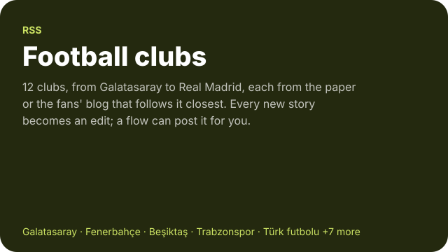</a>
<a href="news">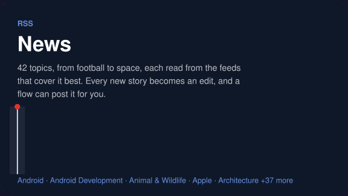</a>
<a href="rss-anime">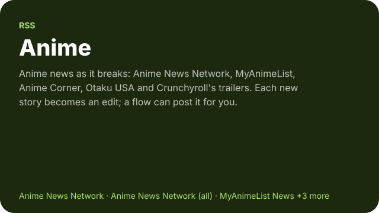</a>
<a href="world">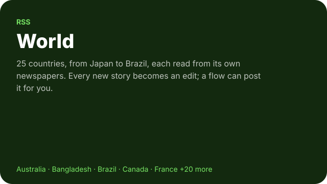</a>

## Presets

<a href="blur-reveal">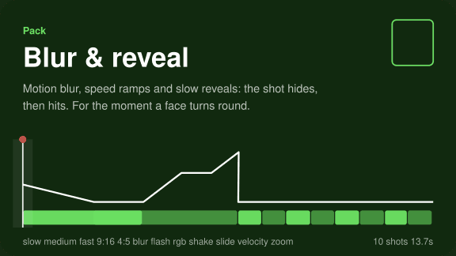</a>
<a href="character">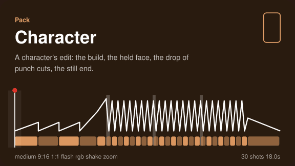</a>
<a href="cinematic">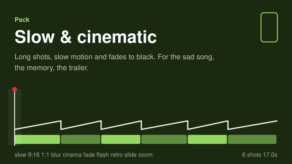</a>
<a href="glitch">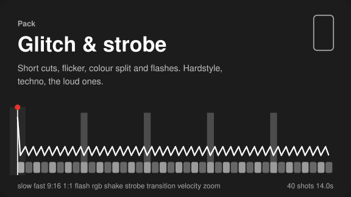</a>
<a href="playful">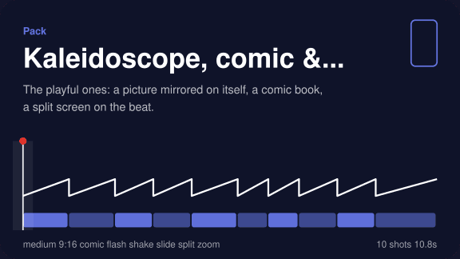</a>
<a href="punch-whip">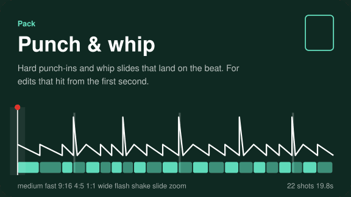</a>
<a href="series">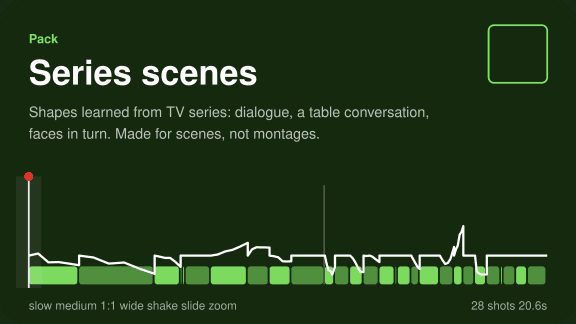</a>
<a href="shake-slide">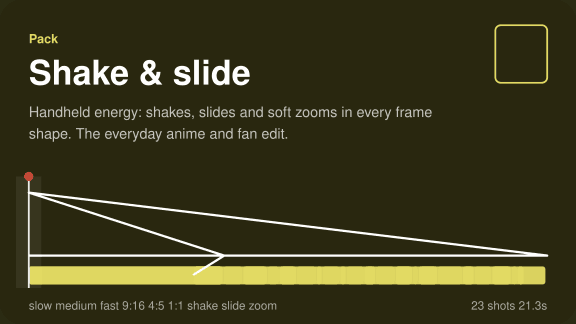</a>
<a href="spin">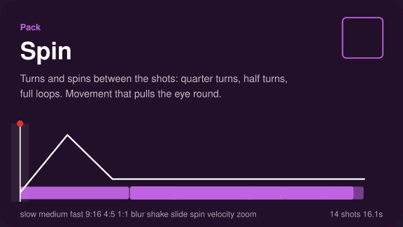</a>
<a href="tape">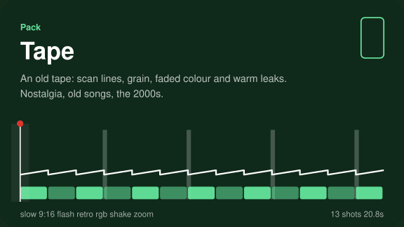</a>
<a href="velocity">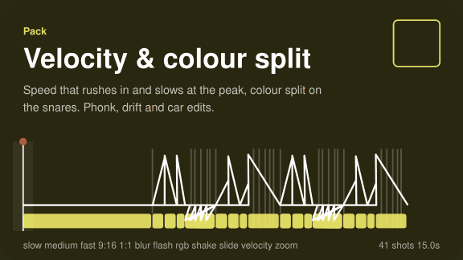</a>

## Automations

<a href="post">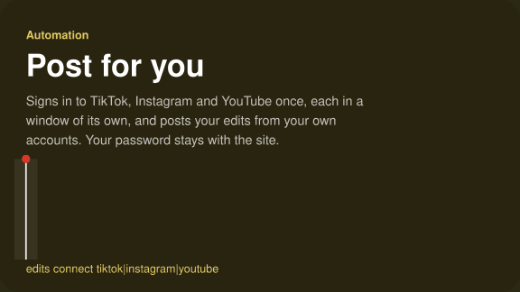</a>

## Agent skills

<a href="edits">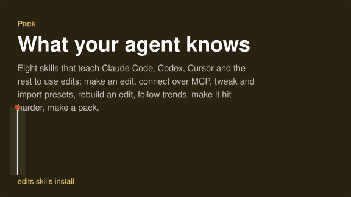</a>
<a href="embers">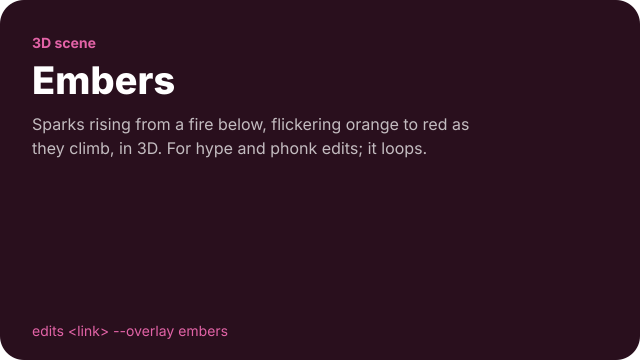</a>
<a href="sakura">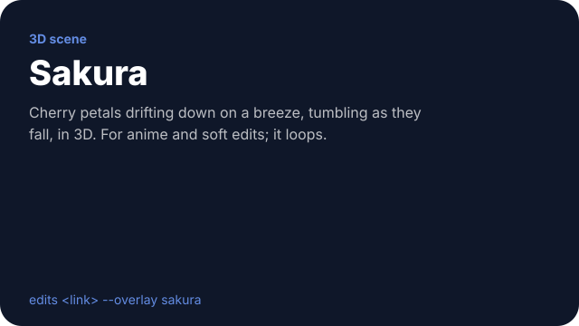</a>
<a href="snow">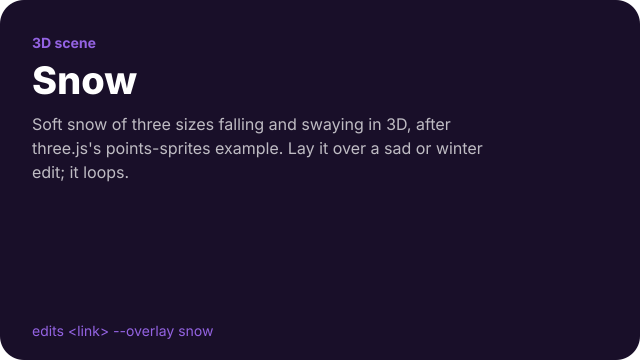</a>
<a href="stardust">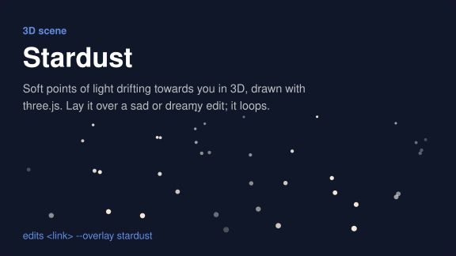</a>
<a href="warp">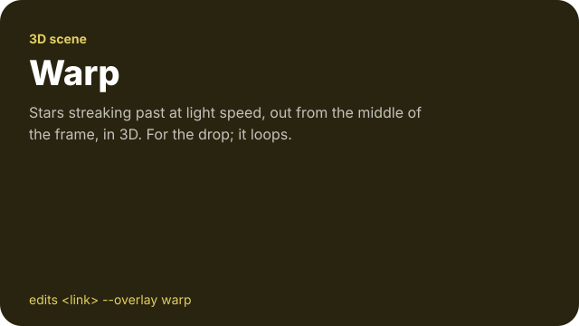</a>

