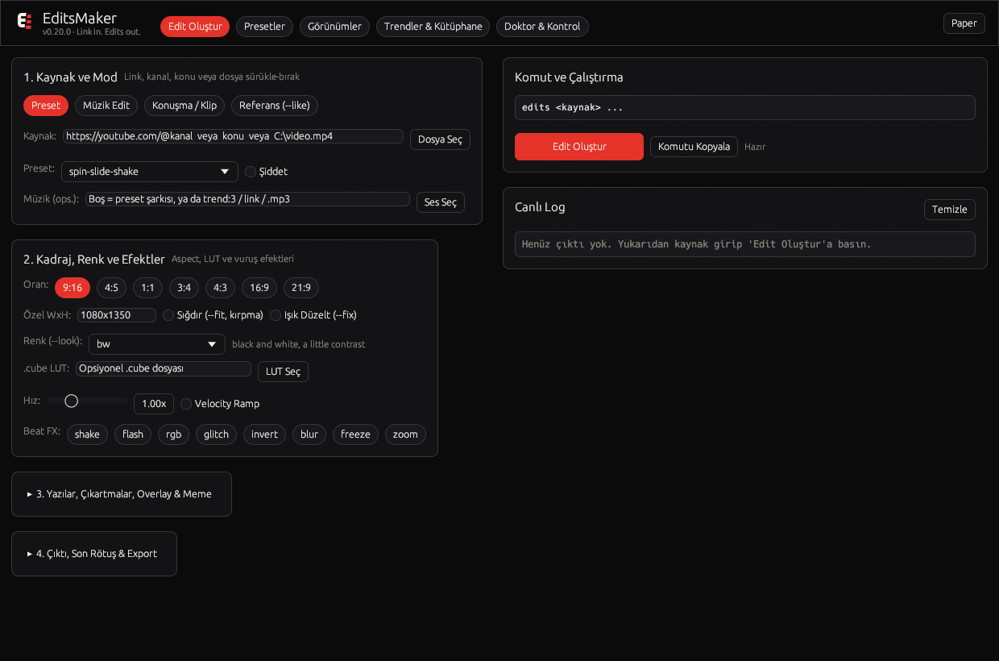
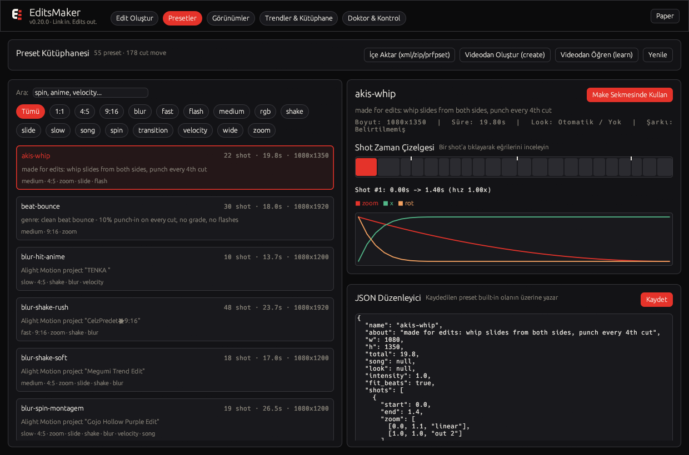
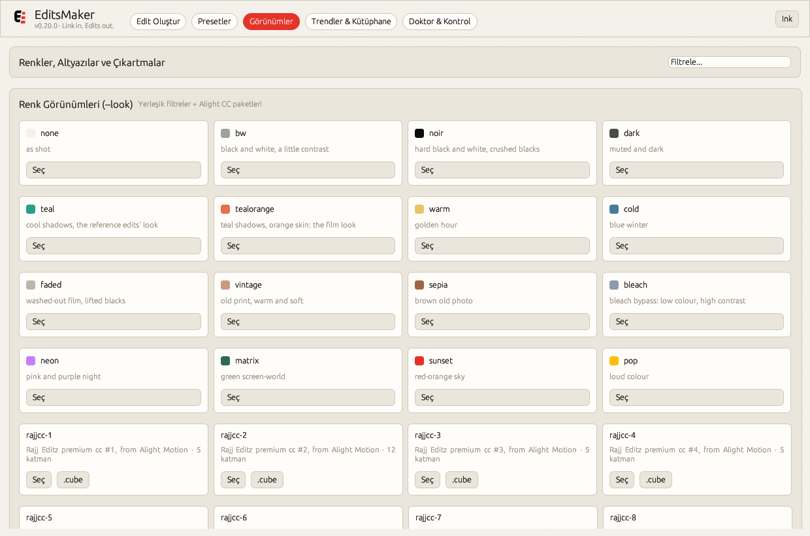
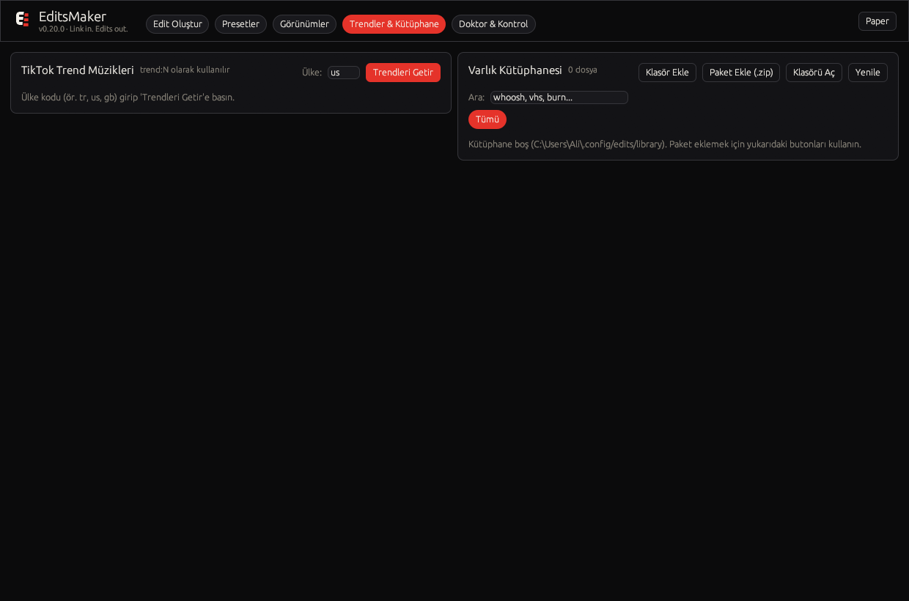
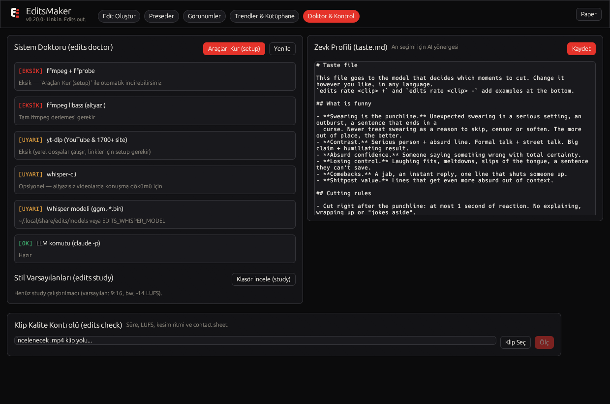

# edits-ui

Native Rust desktop GUI for [EditsMaker](../README.md), built with `eframe` / `egui` using the design tokens in [`design/tokens.css`](../design/tokens.css).

## Run

```sh
cargo run -p edits-ui --release
```

Or build both binaries:

```sh
cargo build --workspace --release
```

## Features

- **Make (`Edit Oluştur`)**: Preset, Music, Talking Clips, and Reference (`--like`) modes with drag-and-drop video input, aspect/look/LUT/FX controls, live CLI command preview, output clip cards, and real-time log streaming.
- **Presets (`Presetler`)**: Search and tag-filter all built-in and user presets, inspect shot timelines and animation curves (`zoom`, `x`, `y`, `rot`, `shake`, `blur`, `ramp`), edit/validate/save JSON, and run `learn` / `create` / `import`.
- **Looks (`Görünümler`)**: Browse built-in colour looks, Alight Motion CC grades (with `.cube` LUT export), caption styles, and SVG stickers.
- **Trends & Library (`Trendler & Kütüphane`)**: Fetch TikTok trending tracks by country and browse/import asset packs in `~/.config/edits/library`.
- **Doctor & Check (`Doktor & Kontrol`)**: Check `ffmpeg`, `ffprobe`, `libass`, `yt-dlp`, `whisper-cli`, edit `taste.md`, and inspect rendered clips with contact-sheet previews (`edits check`).

## Screenshots

| Make (`Ink`) | Presets & Curve Plotter |
| --- | --- |
|  |  |

| Looks & Styles (`Paper`) | Trends & Library | Doctor & Check |
| --- | --- | --- |
|  |  |  |

